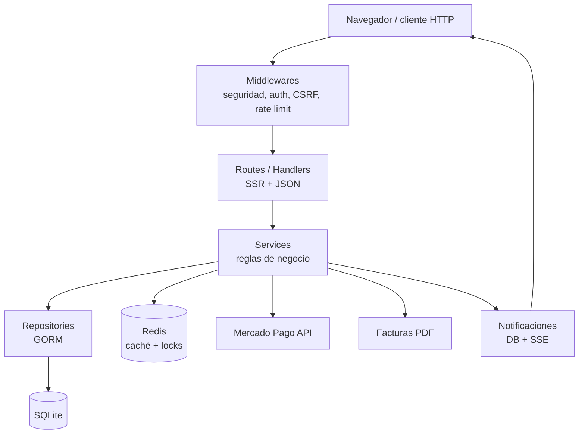
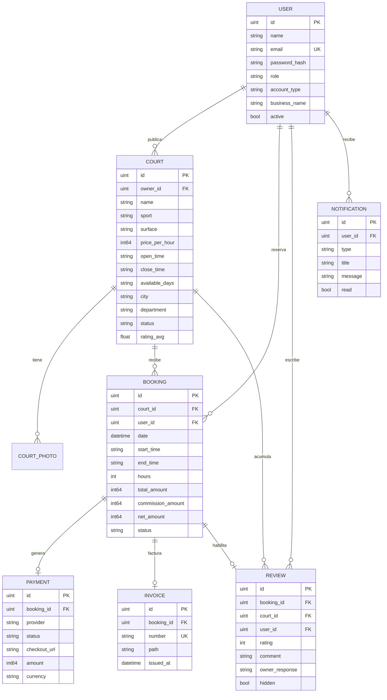
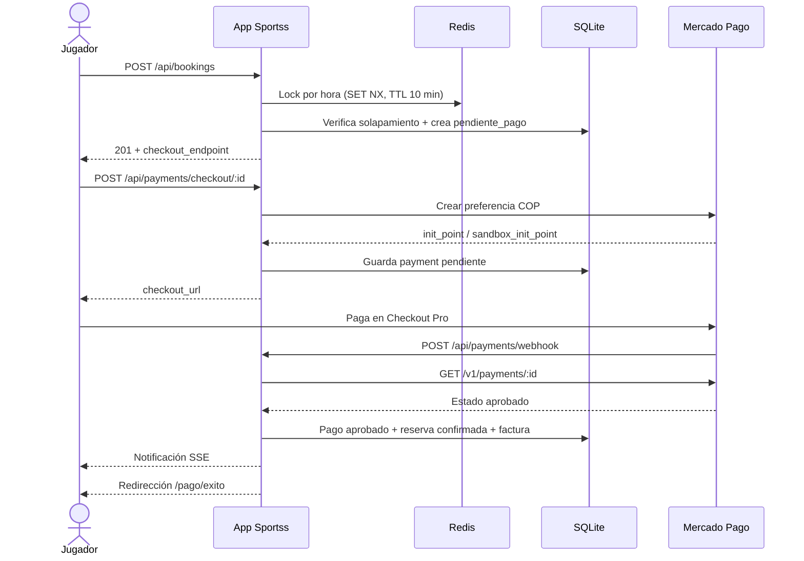

# Sportss Colombia

Plataforma SaaS para reservar canchas deportivas por hora en Colombia. Incluye sitio público con búsqueda y filtros, reservas con pago en línea, panel para dueños de complejos deportivos, panel global de superadministración, facturas PDF y notificaciones en tiempo real.

El proyecto es una aplicación **Go + Gin con renderizado del lado del servidor (SSR)**, pensada para ejecutarse con SQLite y Redis. No requiere Node.js ni un frontend separado: las vistas se generan con `html/template` y la interactividad se resuelve con JavaScript vanilla.

---

## 1. Descripción general

Sportss Colombia conecta a jugadores con complejos deportivos. Un jugador busca una cancha, elige fecha y horas consecutivas, crea una reserva y paga con Mercado Pago (o con el checkout simulado de desarrollo). Al confirmarse el pago, la reserva queda confirmada, se genera una factura PDF y ambas partes reciben notificaciones.

Una cuenta de empresa puede publicar y administrar sus canchas, ver la ocupación de su negocio, gestionar reservas y responder reseñas. El superadministrador supervisa usuarios, canchas, reseñas, pagos y métricas globales.

| Aspecto | Implementación |
|---|---|
| Nombre comercial | Sportss Colombia |
| Idioma | Español (Colombia) |
| Moneda | Peso colombiano (COP) |
| Zona horaria por defecto | `America/Bogota` |
| Tipo de aplicación | SaaS monolítico SSR |
| Persistencia | SQLite (sin CGO) |
| Caché y bloqueos | Redis (con respaldo en memoria para desarrollo) |
| Pagos | Mercado Pago Checkout Pro + modo simulado local |
| Autenticación | JWT en cookie HttpOnly + CSRF double-submit |

---

## 2. Características principales

### Sitio público
- Página de inicio con canchas destacadas, deportes y ciudades.
- Búsqueda por texto, deporte, ciudad, departamento, precio mínimo/máximo, cancha cubierta, fecha, hora y orden.
- Paginación y filtros combinables.
- Ficha de cancha con galería, servicios, mapa de OpenStreetMap, reseñas y calendario de disponibilidad.
- Diseño responsive mobile-first, accesible, con estados de carga, errores, toasts y diálogos de confirmación.
- Paleta visual de tres colores: verde teal `#0f766e`, ámbar `#f59e0b` y neutros.

### Jugadores
- Registro e inicio de sesión.
- Reserva por hora o varias horas consecutivas.
- Bloqueo temporal del horario mientras se paga.
- Checkout con Mercado Pago o simulación local.
- Historial de reservas, estados y facturas PDF.
- Cancelación según la política configurable.
- Reseñas verificadas únicamente después de una reserva completada.
- Perfil, cambio de contraseña y preferencias de notificación.
- Notificaciones persistentes y en tiempo real por SSE.

### Dueños de canchas
- Panel con métricas: ingresos, reservas, ocupación y canchas más reservadas.
- Gráficas de ingresos y reservas por mes/día (Chart.js).
- CRUD de canchas con fotos, servicios, horarios, días disponibles, precio y ubicación.
- Gestión de reservas: cancelar y marcar como completadas.
- Respuesta pública a reseñas.
- Aislamiento por propietario: un dueño solo administra sus propias canchas y reservas.

### Superadministrador
- Panel global con métricas de toda la plataforma.
- Gestión de usuarios (activar/desactivar).
- Moderación de canchas y reseñas.
- Reportes globales y por periodo.
- Acceso al panel de negocio para soporte.

### Plataforma
- Facturación PDF consecutiva con numeración `FAC-AAAA-000000`.
- Comisión configurable por reserva y desglose bruto/comisión/neto.
- Tareas automáticas cada minuto: expiración de pagos pendientes, recordatorios y finalización de reservas.
- Caché de búsquedas y disponibilidad con invalidación.
- Cabeceras de seguridad, CSP, límite de cuerpo, rate limit de login y recuperación ante pánicos.

---

## 3. Stack tecnológico

| Capa | Tecnología |
|---|---|
| Lenguaje | Go 1.27.1 (probado con esta versión) |
| Framework HTTP | Gin `v1.12.0` |
| Plantillas | `html/template` con partials y funciones propias |
| Frontend | HTML SSR, CSS propio, JavaScript vanilla |
| Base de datos | SQLite mediante `github.com/glebarez/sqlite` (driver puro Go, sin CGO) |
| ORM | GORM `v1.31.2` |
| Redis | `github.com/redis/go-redis/v9` |
| Pagos | API REST de Mercado Pago Checkout Pro |
| PDF | `github.com/jung-kurt/gofpdf` |
| Autenticación | JWT `github.com/golang-jwt/jwt/v5` + bcrypt |
| Configuración | `github.com/joho/godotenv` |
| Gráficas | Chart.js (CDN, cargado por las vistas de panel) |
| Contenedores | Docker Compose para Redis |

> El proyecto no usa Node.js, bundlers, React, Vue ni bases de datos externas obligatorias.

---

## 4. Arquitectura del sistema

La aplicación sigue una arquitectura por capas. `cmd/server/main.go` solo construye dependencias, registra rutas y arranca el servidor; la lógica de negocio vive en servicios y el acceso a datos en repositorios.



Principios aplicados:

- **Separación estricta de responsabilidades:** handlers delgados, servicios con reglas, repositorios con consultas.
- **Transacciones:** creación de reservas, pagos y facturas con controles de concurrencia.
- **Doble protección de solapamientos:** índice único parcial en SQLite + verificación transaccional + lock Redis `SET NX`.
- **SSR primero:** las páginas funcionan sin JavaScript para navegación y formularios; las acciones dinámicas usan la API JSON.
- **Seguridad por defecto:** cookies HttpOnly, CSRF, CSP sin scripts inline, validación y autorización por rol/propietario.

---

## 5. Estructura del proyecto

```text
sportss colombia/
├── cmd/
│   └── server/
│       └── main.go              # Wiring, middleware, scheduler y arranque
├── internal/
│   ├── cache/                   # Redis + fallback en memoria
│   ├── config/                  # Variables de entorno y rutas
│   ├── database/                # Conexión, migraciones y seed
│   ├── handlers/                # Vistas SSR y endpoints JSON
│   ├── middleware/              # Auth, CSRF, seguridad, rate limit, recovery
│   ├── models/                  # Entidades y estados
│   ├── payments/                # Cliente de Mercado Pago
│   ├── pdf/                     # Generación de facturas
│   ├── repositories/            # Consultas y transacciones GORM
│   ├── routes/                  # Registro de rutas y permisos
│   └── services/                # Reglas de negocio y scheduler
├── storage/                     # SQLite y facturas (generado en ejecución)
├── web/
│   ├── static/
│   │   ├── css/styles.css       # Sistema de diseño
│   │   ├── img/                 # Ilustraciones SVG y favicon
│   │   └── js/                  # app, court, court-form, dashboard, account
│   └── templates/
│       ├── pages/               # Vistas completas
│       └── partials/            # Navegación, pie, tarjetas, base
├── .env.example
├── docker-compose.yml           # Redis
├── Makefile
├── go.mod
├── go.sum
└── README.md
```

Los archivos generados (`storage/sportss.db`, `storage/invoices/*.pdf`, `web/static/uploads/*`) no forman parte del código fuente y deben respaldarse o excluirse según el entorno.

---

## 6. Requisitos previos

- **Go 1.27.1 o superior** (el `go.mod` declara `go 1.27.1`).
- **Docker Desktop** con Docker Compose para Redis (recomendado).
- Puerto **8080** libre, o el que definas en `APP_PORT`.
- Cuenta de **Mercado Pago** solo si vas a probar pagos reales/sandbox. Sin credenciales, la app funciona con checkout simulado.
- Opcional para webhooks reales: **ngrok** u otro túnel HTTPS.

Verifica el entorno:

```bash
go version
docker --version
docker compose version
```

> En Windows puedes usar PowerShell. Los comandos de ejemplo muestran equivalentes cuando aplica.

---

## 7. Instalación y ejecución

### 7.1 Clonar o abrir el proyecto

```bash
cd "sportss colombia"
```

### 7.2 Crear el archivo de entorno

Linux/macOS:

```bash
cp .env.example .env
```

Windows PowerShell:

```powershell
Copy-Item .env.example .env
```

Edita `.env` y cambia al menos `APP_SECRET` y `JWT_SECRET` si vas a compartir el proyecto.

### 7.3 Descargar dependencias

```bash
go mod download
```

### 7.4 Levantar Redis

```bash
docker compose up -d redis
```

Comprueba que responde:

```bash
docker compose ps
```

> Si Redis no está disponible, la aplicación arranca igualmente con caché y locks en memoria, pero muestra una advertencia. Ese modo solo es seguro para una instancia y desarrollo local.

### 7.5 Ejecutar

```bash
go run ./cmd/server
```

o con el Makefile:

```bash
make run
```

Abre **http://localhost:8080**. Health check: **http://localhost:8080/healthz**.

La primera ejecución crea `storage/sportss.db`, aplica migraciones y carga datos de demostración. Si la base ya contiene usuarios, el seed se omite.

### 7.6 Compilar un binario

```bash
make build
# o
go build -trimpath -o bin/sportss ./cmd/server
```

En Windows el binario puede llamarse `sportss.exe`. Ejecútalo desde la raíz del proyecto para que las rutas relativas de plantillas, estáticos y almacenamiento funcionen.

---

## 8. Variables de entorno

Todas las variables se cargan desde `.env` (si existe) y luego desde el entorno del proceso. El archivo `.env.example` contiene una plantilla comentada.

| Variable | Por defecto | Descripción |
|---|---|---|
| `APP_NAME` | `Sportss Colombia` | Nombre visible de la aplicación. |
| `APP_ENV` | `development` | `development` o `production`. Controla logs, modo Gin, HSTS y cookies seguras por defecto. |
| `APP_PORT` | `8080` | Puerto HTTP. |
| `APP_BASE_URL` | `http://localhost:8080` | URL pública; se usa en back URLs y webhook de Mercado Pago. |
| `APP_TIMEZONE` | `America/Bogota` | Zona horaria para fechas, horas y reportes. |
| `APP_SECRET` | Valor de desarrollo | Secreto general de la aplicación. Cámbialo en producción. |
| `JWT_SECRET` | Igual a `APP_SECRET` | Clave de firma de los JWT. Usa un valor independiente y largo. |
| `COOKIE_NAME` | `sportss_token` | Nombre de la cookie de sesión. |
| `COOKIE_SECURE` | `true` en producción | Exige HTTPS para la cookie de sesión. En local con HTTP debe ser `false`. |
| `SQLITE_PATH` | `storage/sportss.db` | Ruta del archivo SQLite. |
| `REDIS_ADDR` | `localhost:6379` | Dirección de Redis. |
| `REDIS_PASSWORD` | vacío | Contraseña de Redis. |
| `REDIS_DB` | `0` | Base lógica de Redis. |
| `MP_ACCESS_TOKEN` | vacío | Access token de Mercado Pago. Si está vacío se activa el modo simulado. |
| `MP_PUBLIC_KEY` | vacío | Public key de Mercado Pago (reservada para integraciones de frontend). |
| `MP_WEBHOOK_SECRET` | vacío | Secreto para validar la firma `x-signature` del webhook. |
| `MP_SANDBOX` | `true` | Usa `sandbox_init_point` al crear el checkout. |
| `COMMISSION_PERCENT` | `10` | Comisión de la plataforma (0–100). |
| `BOOKING_LOCK_MINUTES` | `10` | TTL del lock Redis por hora reservada. |
| `PENDING_EXPIRATION_MINUTES` | `10` | Minutos antes de expirar una reserva pendiente de pago. |
| `CANCELLATION_HOURS` | `24` | Antelación mínima para cancelar. `0` desactiva la restricción. |
| `UPLOAD_MAX_MB` | `5` | Tamaño máximo por imagen (1–20 MB). |
| `STORAGE_DIR` | `storage` | Directorio de datos generados. |
| `INVOICE_DIR` | `storage/invoices` | Directorio de facturas PDF. |
| `UPLOAD_DIR` | `web/static/uploads` | Directorio público de fotos subidas. |
| `TEMPLATE_DIR` | `web/templates` | Directorio de plantillas. |
| `STATIC_DIR` | `web/static` | Directorio de estáticos. |

### Ejemplo mínimo para desarrollo

```dotenv
APP_ENV=development
APP_PORT=8080
APP_BASE_URL=http://localhost:8080
APP_SECRET=un-secreto-local-largo
JWT_SECRET=otro-secreto-local-largo
SQLITE_PATH=storage/sportss.db
REDIS_ADDR=localhost:6379
COMMISSION_PERCENT=10
PENDING_EXPIRATION_MINUTES=10
CANCELLATION_HOURS=24
COOKIE_SECURE=false
```

### Notas de producción

- Usa `APP_ENV=production`, `COOKIE_SECURE=true` y HTTPS.
- Define secretos largos y distintos para `APP_SECRET`, `JWT_SECRET` y `MP_WEBHOOK_SECRET`.
- `APP_BASE_URL` debe ser la URL pública HTTPS para que Mercado Pago pueda llamar al webhook.
- No publiques el archivo `.env`.

---

## 9. Base de datos, migraciones y seed

### Migraciones

Al iniciar, GORM ejecuta `AutoMigrate` sobre las entidades y luego crea índices explícitos:

- `idx_active_booking_slot`: índice único parcial sobre `(court_id, date, start_time)` para reservas con estado `pendiente_pago`, `confirmada` o `completada`.
- `idx_booking_status_date`: acelera reportes y listados por estado/fecha.
- `idx_booking_created_at`: acelera expiración de pendientes.

El índice parcial es la última barrera contra dobles reservas: una reserva cancelada o expirada no bloquea el horario, pero una activa sí.

SQLite se configura con:

- `foreign_keys=ON`
- `busy_timeout=5000`
- `journal_mode=WAL`
- Una sola conexión de escritura (`MaxOpenConns=1`) para reducir locks.

### Modelo de datos



### Datos de demostración

El seed se ejecuta solo si la tabla `users` está vacía y crea:

- 4 usuarios (1 admin, 2 dueños, 1 jugador).
- 6 canchas en Bogotá, Medellín, Cali y Cartagena.
- 6 reservas de ejemplo (completadas, confirmadas y una pendiente).
- 3 reseñas.
- 3 notificaciones.

Para reiniciar desde cero en desarrollo, detén el servidor y elimina la base y los archivos generados:

```powershell
Remove-Item storage\sportss.db* -Force -ErrorAction SilentlyContinue
Remove-Item storage\invoices\* -Force -ErrorAction SilentlyContinue
```

En Linux/macOS:

```bash
rm -f storage/sportss.db storage/sportss.db-shm storage/sportss.db-wal
rm -f storage/invoices/*.pdf
```

> No borres estos archivos en producción sin un respaldo.

---

## 10. Usuarios de demostración

| Rol | Correo | Contraseña | Acceso |
|---|---|---|---|
| Superadministrador | `admin@sportss.co` | `Admin123!` | `/admin/*` y `/panel` |
| Dueño de canchas | `dueno@sportss.co` | `Dueno123!` | `/panel` (Complejo Deportivo El Gol) |
| Dueña de canchas | `duena2@sportss.co` | `Dueno123!` | `/panel` (Arena Pacífico) |
| Jugador | `jugador@sportss.co` | `Jugador123!` | Reservas, perfil, reseñas |

> Estas credenciales son solo para demostración. Cámbialas o elimina los usuarios antes de desplegar en producción.

El registro público crea cuentas `persona` (jugador) o `empresa` (dueño de canchas). No es posible registrarse como superadministrador desde la interfaz.

---

## 11. Roles y permisos

| Acción | Jugador | Dueño de canchas | Superadmin |
|---|---:|---:|---:|
| Buscar y ver canchas | Sí | Sí | Sí |
| Reservar y pagar | Sí | Sí | Sí |
| Ver sus propias reservas | Sí | Sí | Sí |
| Cancelar su reserva | Sí* | Sí* | Sí* |
| Publicar/editar canchas | No | Solo propias | Sí (moderación) |
| Ver reservas de sus canchas | No | Solo propias | Todas |
| Marcar reservas como completadas | No | Solo propias | Todas |
| Responder reseñas | No | Solo de sus canchas | Sí |
| Moderar reseñas | No | No | Sí |
| Activar/desactivar usuarios | No | No | Sí |
| Ver reportes globales | No | Solo su negocio | Globales |

\* La cancelación del jugador está limitada por `CANCELLATION_HOURS` para reservas confirmadas. El dueño y el admin pueden cancelar desde el panel con las reglas del servicio. Las reservas pendientes de pago se pueden cancelar de inmediato.

Reglas de autorización:

- El middleware `RequireAuth` exige sesión para rutas privadas.
- `RequireBusiness` permite `business` y `admin`.
- `RequireAdmin` solo permite `admin`.
- Los servicios verifican propiedad de canchas, reservas y reseñas antes de modificar.

---

## 12. Reservas, disponibilidad y bloqueos

### Reglas de negocio

1. La fecha no puede ser pasada.
2. La cancha debe estar activa.
3. El día debe estar dentro de `available_days`.
4. La hora debe estar dentro de `open_time`–`close_time`.
5. Se permiten entre **1 y 12 horas consecutivas**.
6. No se permite solapamiento con reservas `pendiente_pago`, `confirmada` o `completada`.
7. La reserva nace en estado `pendiente_pago` y expira a los `PENDING_EXPIRATION_MINUTES`.
8. Al confirmar el pago pasa a `confirmada`; el dueño o el scheduler la marcan `completada`.
9. Las reservas canceladas o expiradas liberan el horario.
10. La disponibilidad pública se calcula por hora y descuenta los estados activos.

### Flujo de creación

```text
POST /api/bookings
  → valida cancha, fecha, día, horario y pasado
  → adquiere lock Redis por cada hora (SET NX, TTL BOOKING_LOCK_MINUTES)
  → transacción: verifica solapamiento y crea booking pendiente_pago
  → invalida caché de búsquedas
  → notifica al jugador y al dueño
  → devuelve booking + checkout_endpoint
```

La reserva pendiente también protege el horario en la base de datos, por lo que el lock es una optimización de concurrencia y la base de datos es la fuente de verdad. Al cancelar una reserva o al expirar un pago pendiente se liberan sus locks para permitir reservar el horario de inmediato.

### Expiración, recordatorios y finalización

Un scheduler interno se ejecuta cada minuto:

- Expira reservas `pendiente_pago` antiguas.
- Envía un recordatorio para reservas confirmadas próximas (una sola vez, marcando `reminder_sent`).
- Marca como `completada` una reserva confirmada cuya hora final ya pasó.

### Estados

```text
pendiente_pago ──pago aprobado──▶ confirmada ──hora finalizada──▶ completada
       │                               │
       ├──cancelada por usuario        ├──cancelada por dueño/admin
       └──expirada por tiempo          └──(si aplica) reembolso manual
```

---

## 13. Búsqueda, filtros y caché

`GET /buscar` y `GET /api/courts` aceptan:

| Parámetro | Valores / ejemplo | Descripción |
|---|---|---|
| `q` | `fútbol`, `Salitre` | Texto en nombre, descripción, ciudad, barrio o dirección. |
| `sport` | `Fútbol 5`, `Tenis` | Deporte exacto. |
| `city` | `Bogotá` | Ciudad (sin distinguir mayúsculas). |
| `department` | `Cundinamarca` | Departamento. |
| `min_price` / `max_price` | `80000` | Rango de precio por hora en COP. |
| `covered` | `si` / `no` | Cancha cubierta. |
| `date` | `2026-11-20` | Día disponible. |
| `hour` | `18:00` | Hora libre para la fecha indicada. |
| `sort` | `relevance`, `price_asc`, `price_desc`, `rating` | Ordenamiento. |
| `page` | `1` | Paginación (9 resultados por página en búsqueda). |

La búsqueda se cachea en Redis durante **2 minutos** y las canchas destacadas **3 minutos**. La disponibilidad se calcula en vivo contra las reservas activas para no mostrar horarios ocupados. Al crear, cancelar o modificar una reserva, o al cambiar una cancha, se invalida el prefijo `courts:search:` para evitar resultados obsoletos.

Si Redis no está disponible, se usa un `MemoryStore` con la misma interfaz. No compartas ese modo entre varias instancias.

---

## 14. Pagos con Mercado Pago

### Modo simulado (por defecto)

Si `MP_ACCESS_TOKEN` está vacío, la aplicación crea una URL local:

```text
/checkout/mock/<bookingID>
```

El jugador confirma el pago simulado y la reserva se confirma, se genera la factura y se disparan las notificaciones. Este modo es solo para desarrollo y demostración.

### Checkout Pro real

1. Crea una aplicación en el panel de desarrolladores de Mercado Pago.
2. Obtén el **Access Token** de prueba o producción.
3. Configura en `.env`:

```dotenv
APP_BASE_URL=https://tu-dominio-o-tunel.ngrok-free.app
MP_ACCESS_TOKEN=TEST-xxxxxxxxxxxxxxxx
MP_PUBLIC_KEY=TEST-xxxxxxxxxxxxxxxx
MP_WEBHOOK_SECRET=tu-secreto-de-firma
MP_SANDBOX=true
```

4. Expón el servidor con HTTPS. Ejemplo con ngrok:

```bash
ngrok http 8080
```

5. Copia la URL HTTPS en `APP_BASE_URL` y reinicia la aplicación.
6. En Mercado Pago, configura la URL de notificaciones:

```text
https://tu-dominio-o-tunel/api/payments/webhook
```

7. Prueba con las tarjetas de prueba de Mercado Pago.

La preferencia se crea en **COP**, con `external_reference = bookingID`. Cuando llega el webhook, el servidor:

1. Valida la firma `x-signature` si `MP_WEBHOOK_SECRET` está configurado.
2. Consulta el pago real a la API de Mercado Pago (`GET /v1/payments/:id`).
3. Verifica que el monto y la referencia correspondan a la reserva.
4. Actualiza pago y reserva de forma idempotente.
5. Genera la factura PDF y notifica al jugador y al dueño.



### Webhook sin secreto

Si `MP_WEBHOOK_SECRET` está vacío, el webhook acepta la petición (útil solo en desarrollo). En producción configura siempre el secreto.

### Idempotencia

- Un pago por reserva (`payments.booking_id` es único).
- La factura por reserva también es única.
- Un webhook repetido no duplica pagos ni facturas.
- Solo se confirma una reserva si el pago consultado está aprobado.

---

## 15. Facturas PDF

Al confirmar el pago se genera una factura PDF con `gofpdf` y se guarda en `storage/invoices/`.

- Numeración consecutiva: `FAC-<año>-<6 dígitos>`, por ejemplo `FAC-2026-000007`.
- Datos incluidos: número, fecha de emisión, cliente, documento, negocio, NIT del negocio, cancha, deporte, ciudad, fecha/hora de la reserva, horas, precio por hora, total, comisión, neto y método de pago.
- Soporte de acentos mediante el traductor Unicode de gofpdf.
- Descarga protegida: `GET /facturas/<bookingID>/descargar` valida que la reserva pertenezca al usuario (o que sea admin).
- La factura se puede regenerar si el archivo se elimina; el registro se conserva.

> Es un comprobante comercial generado por la plataforma. **No es una factura electrónica validada ante la DIAN.** Para producción fiscal en Colombia se debe integrar un proveedor autorizado de facturación electrónica.

---

## 16. Notificaciones en tiempo real (SSE)

Las notificaciones se guardan en la tabla `notifications` y se entregan por **Server-Sent Events**.

- Endpoint: `GET /api/notifications/stream`.
- Requiere sesión activa.
- Envía eventos con las notificaciones no leídas y mantiene la conexión abierta.
- El cliente reconecta automáticamente si la conexión se corta.
- El panel de notificaciones se carga con `GET /api/notifications` y se renderiza con DOM seguro (sin `innerHTML` con datos del usuario).
- `POST /api/notifications/:id/read` marca una como leída.
- `POST /api/notifications/read-all` marca todas como leídas.
- El contador de no leídas se muestra en la navegación.

Eventos generados por la aplicación:

| Tipo | Cuándo |
|---|---|
| `reserva_creada` | Al crear una reserva pendiente. |
| `nueva_reserva` | Aviso al dueño de la cancha. |
| `pago_confirmado` | Al aprobarse el pago. |
| `reserva_cancelada` | Al cancelar jugador, dueño o admin. |
| `recordatorio` | Antes del inicio de una reserva confirmada. |
| `reserva_completada` | Al completarse la reserva. |
| `nueva_resena` | Cuando un jugador publica una reseña. |

> El envío de correos electrónicos no está implementado. `EmailNotify` es una preferencia de perfil y las notificaciones son in-app. Si necesitas correo, integra un proveedor SMTP/transaccional en `NotificationService`.

### Consideración de despliegue

El canal SSE es en memoria del proceso. Funciona correctamente con una instancia. Para varias réplicas se necesita un bus compartido (por ejemplo Redis Pub/Sub) delante de SSE.

---

## 17. API y rutas

### Públicas

| Método | Ruta | Descripción |
|---|---|---|
| `GET` | `/` | Inicio. |
| `GET` | `/buscar` | Búsqueda SSR con filtros y paginación. |
| `GET` | `/canchas/:id` | Ficha de cancha. |
| `GET` | `/login` | Formulario de acceso. |
| `GET` | `/registro` | Formulario de registro. |
| `GET` | `/healthz` | Health check JSON. |
| `GET` | `/static/*` | Archivos estáticos. |
| `GET` | `/api/courts` | Búsqueda JSON de canchas. |
| `GET` | `/api/courts/:id` | Detalle JSON de cancha. |
| `GET` | `/api/courts/:id/availability?date=AAAA-MM-DD` | Disponibilidad por hora. |
| `POST` | `/api/payments/webhook` | Webhook de Mercado Pago (sin CSRF). |

### Autenticación

| Método | Ruta | Descripción |
|---|---|---|
| `POST` | `/login` | Login SSR (rate limit). |
| `POST` | `/registro` | Registro SSR (rate limit). |
| `POST` | `/api/auth/login` | Login JSON (rate limit). |
| `POST` | `/api/auth/register` | Registro JSON (rate limit). |

### Sesión, perfil y reservas

| Método | Ruta | Descripción |
|---|---|---|
| `POST` | `/logout` | Cierra sesión SSR. |
| `POST` | `/api/auth/logout` | Cierra sesión JSON. |
| `GET` | `/perfil` | Perfil del usuario. |
| `POST` | `/perfil` | Actualiza perfil. |
| `POST` | `/perfil/password` | Cambia contraseña. |
| `GET` | `/mis-reservas` | Historial de reservas. |
| `GET` | `/facturas/:id/descargar` | Descarga la factura PDF de una reserva. |
| `GET` | `/checkout/mock/:id` | Checkout simulado (solo sin credenciales MP). |
| `POST` | `/checkout/mock/:id/confirmar` | Confirma pago simulado. |
| `GET` | `/pago/exito` | Resultado exitoso. |
| `GET` | `/pago/pendiente` | Resultado pendiente. |
| `GET` | `/pago/fallo` | Resultado fallido. |
| `POST` | `/api/bookings` | Crea reserva. |
| `GET` | `/api/bookings/:id` | Consulta reserva accesible. |
| `POST` | `/api/bookings/:id/cancel` | Cancela reserva. |
| `POST` | `/api/bookings/:id/complete` | Completar reserva (dueño/admin). |
| `POST` | `/api/payments/checkout/:id` | Inicia checkout. |

### Notificaciones y reseñas

| Método | Ruta | Descripción |
|---|---|---|
| `GET` | `/api/notifications` | Lista notificaciones. |
| `GET` | `/api/notifications/stream` | Stream SSE. |
| `POST` | `/api/notifications/:id/read` | Marca una como leída. |
| `POST` | `/api/notifications/read-all` | Marca todas como leídas. |
| `POST` | `/api/reviews` | Crea reseña de reserva completada. |
| `POST` | `/api/reviews/:id/respond` | Responde reseña (dueño/admin). |

### Panel de dueño

| Método | Ruta | Descripción |
|---|---|---|
| `GET` | `/panel` | Dashboard con métricas. |
| `GET` | `/panel/canchas` | Lista de canchas propias. |
| `GET` | `/panel/canchas/nueva` | Formulario de nueva cancha. |
| `POST` | `/panel/canchas` | Crea cancha. |
| `GET` | `/panel/canchas/:id/editar` | Edita cancha. |
| `POST` | `/panel/canchas/:id` | Guarda cambios. |
| `POST` | `/panel/canchas/:id/estado` | Activa/pausa cancha. |
| `POST` | `/panel/canchas/:id/eliminar` | Elimina cancha. |
| `GET` | `/panel/reservas` | Reservas de sus canchas. |
| `POST` | `/panel/reservas/:id/cancelar` | Cancela reserva. |
| `POST` | `/panel/reservas/:id/completar` | Completa reserva. |
| `GET` | `/panel/resenas` | Reseñas recibidas. |
| `POST` | `/panel/resenas/:id/responder` | Responde reseña. |

### Superadministración

| Método | Ruta | Descripción |
|---|---|---|
| `GET` | `/admin/usuarios` | Lista de usuarios. |
| `POST` | `/admin/usuarios/:id/estado` | Activa/desactiva usuario. |
| `GET` | `/admin/canchas` | Moderación de canchas. |
| `POST` | `/admin/canchas/:id/estado` | Activa/pausa cancha. |
| `POST` | `/admin/canchas/:id/eliminar` | Elimina cancha. |
| `GET` | `/admin/resenas` | Moderación de reseñas. |
| `POST` | `/admin/resenas/:id/ocultar` | Oculta/muestra reseña. |
| `GET` | `/admin/reportes` | Reportes globales. |

### Uso de la API JSON

Todas las peticiones no seguras requieren el token CSRF. En el navegador se obtiene de la cookie `sportss_csrf` y se envía en la cabecera `X-CSRF-Token`. En formularios SSR se envía en el campo `_csrf`.

Ejemplo de creación de reserva:

```bash
curl -X POST http://localhost:8080/api/bookings \
  -H "Content-Type: application/json" \
  -H "X-CSRF-Token: <token>" \
  -b "sportss_token=<jwt>; sportss_csrf=<token>" \
  -d '{"court_id":3,"date":"2026-11-20","start_time":"18:00","hours":2}'
```

Respuesta:

```json
{
  "message": "Reserva creada. Completa el pago para confirmarla.",
  "booking": { "id": 8, "status": "pendiente_pago" },
  "checkout_endpoint": "/api/payments/checkout/8"
}
```

Errores de negocio devuelven JSON `{ "error": "..." }` con el código HTTP correspondiente (`400`, `403`, `404`, `409`).

---

## 18. Seguridad, limitaciones y despliegue

### Seguridad implementada

- Contraseñas con **bcrypt** (coste por defecto).
- Sesión con **JWT firmado** en cookie **HttpOnly**, `SameSite=Lax` y `Secure` en producción.
- **CSRF double-submit**: cookie `sportss_csrf` + cabecera/campo en cada petición no segura.
- **CSP** que bloquea scripts inline; todo el JavaScript es externo.
- Cabeceras `X-Content-Type-Options`, `X-Frame-Options`, `Referrer-Policy`, `Permissions-Policy` y HSTS en producción.
- Rate limit de **8 intentos / 15 minutos** para login y registro.
- Límite de cuerpo de **32 MB** y validación de tipo/tamaño de imágenes.
- Consultas parametrizadas mediante GORM.
- Autorización por rol y verificación de propiedad en servicios.
- Validación de firma del webhook de Mercado Pago.
- Recuperación de pánicos y logs estructurados con `slog`.
- Renderizado seguro con `html/template` y DOM sin HTML no confiable.

### Limitaciones conocidas

- **SQLite** es ideal para una instancia pequeña/mediana; no es la mejor opción para alta concurrencia multiservidor. Para escalar, migra los repositorios a PostgreSQL.
- El fallback de caché/locks en memoria solo funciona con **una instancia**. En producción usa Redis.
- **SSE** se distribuye en memoria del proceso; con varias réplicas necesitas Pub/Sub.
- No se envían correos electrónicos reales; las notificaciones son in-app.
- No hay OAuth real de Google/Facebook; los botones muestran “Próximamente”.
- No se implementan reembolsos automáticos ni conciliación contable.
- La factura PDF no reemplaza una factura electrónica DIAN.
- El alcance no incluye pruebas automatizadas; se recomienda añadir pruebas de integración antes de producción.
- El modo de pago simulado debe deshabilitarse en producción configurando `MP_ACCESS_TOKEN`.

### Despliegue recomendado

1. Compila el binario con `make build`.
2. Copia el binario, `web/`, `.env` y crea `storage/` en el servidor.
3. Ejecuta desde la raíz del proyecto para conservar rutas relativas.
4. Usa un proxy inverso (Nginx, Caddy, Traefik) con HTTPS.
5. Configura `APP_ENV=production`, `COOKIE_SECURE=true` y `APP_BASE_URL` HTTPS.
6. Levanta Redis y define `REDIS_ADDR`/`REDIS_PASSWORD`.
7. Configura credenciales de Mercado Pago y el webhook.
8. Respalda periódicamente `storage/sportss.db` y `storage/invoices/`.
9. Supervisa `/healthz` y los logs.
10. Rota los secretos y elimina las cuentas de demostración.

### Comandos útiles

```bash
make help        # Lista de comandos
make run         # Servidor en desarrollo
make build       # Binario en bin/sportss
make tidy        # go mod tidy
make fmt         # gofmt
make vet         # go vet
make redis-up    # Redis con Docker Compose
make redis-down  # Detiene Redis
```

### Solución de problemas

| Síntoma | Causa probable | Solución |
|---|---|---|
| `bind: ... puerto en uso` | Ya hay un proceso en el puerto 8080. | Detén el proceso o cambia `APP_PORT`. |
| Redis no disponible | Redis no está levantado. | `docker compose up -d redis`; la app funciona con fallback en memoria. |
| No se puede iniciar sesión tras varios intentos | Rate limit de 8 intentos/15 min. | Espera 15 minutos o reinicia el servidor en desarrollo. |
| Mercado Pago no redirige | Credenciales o `APP_BASE_URL` incorrectos. | Revisa `.env`, usa HTTPS y reinicia. |
| Webhook no llega | URL no pública o túnel caído. | Verifica ngrok/proxy y la URL configurada en Mercado Pago. |
| Factura sin acentos correctos | Fuente/PDF. | La app aplica traducción Unicode; verifica que el texto se guarde en UTF-8. |
| El seed no aparece | La base ya tiene usuarios. | Elimina `storage/sportss.db` en desarrollo y reinicia. |

---

**Sportss Colombia** — Reserva tu juego. Vive el deporte.
